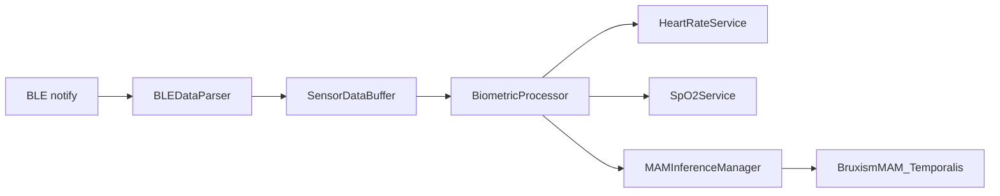
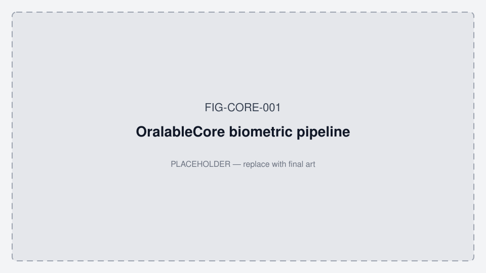
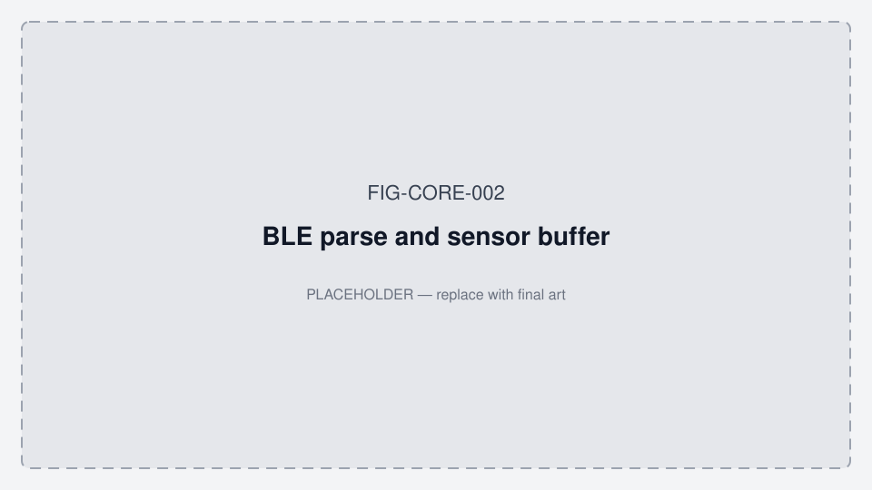
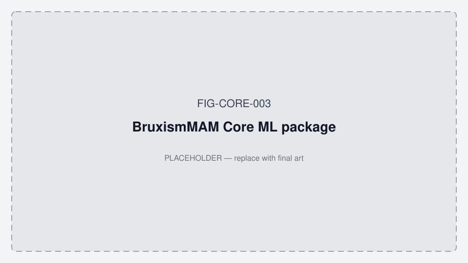

# OralableCore documentation

Shared Swift package: BLE parse, biometrics, CSV, Core ML MAM, design tokens.  
**Figures:** [FIGURES.md](./FIGURES.md) · **Master inventory:** [cursor_oralable/docs/FIGURES.md](../../cursor_oralable/docs/FIGURES.md)

**Canonical algorithm narrative:** [cursor_oralable/docs/ALGORITHM_ARCHITECTURE.md](../../cursor_oralable/docs/ALGORITHM_ARCHITECTURE.md) · **App working diagrams:** [MOBILE_APP_FLOWS.md §2](../../oralable_swift/docs/MOBILE_APP_FLOWS.md#2-how-the-patient-app-works--phase-0)  
**System architecture hub:** [cursor_oralable/docs/ORALABLE_SYSTEM_ARCHITECTURE.md](../../cursor_oralable/docs/ORALABLE_SYSTEM_ARCHITECTURE.md)

**Package boundary contract:** [PACKAGE_BOUNDARIES.md](./PACKAGE_BOUNDARIES.md) — the single-target layer rules and staged modularization plan.

**Agent routing:** topic slug `core` · [AGENTS.md](../../cursor_oralable/AGENTS.md) · [WORKSPACE_TOPICS.md](../../cursor_oralable/docs/WORKSPACE_TOPICS.md)

Do not put FDA / Stage B medical claims in this package’s docs. Stage A = wellness wearable.

**Protocol A seat QC:** `CouplingGate` (`couple` unknown / 0 desk / 1 poor / 2 good) — Mac parity with `cursor_oralable/src/utils/coupling_gate.py`. GATT `worn` stays separate.

## Biometric pipeline (live)

*Figure FIG-CORE-001 — OralableCore biometric pipeline (placeholder).*

*Figure FIG-CORE-002 — BLE parse and sensor buffer (placeholder).*

*Figure FIG-CORE-003 — BruxismMAM Core ML package (placeholder).*

*Last updated: November 2026*
